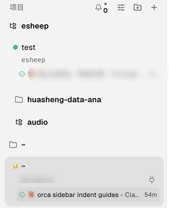
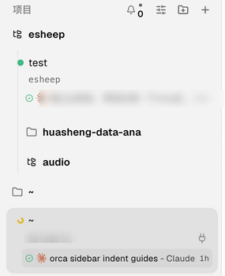

# Better Project Tree for Orca

把 Orca 的项目和工作区画成 VS Code 资源管理器那样的树：每一层缩进，竖线辅助线串起同一层级，上下级一眼分清。

Your Orca projects and workspaces as a VS Code-style explorer tree, with indent guides that make every level easy to follow.


## 功能

- **按文件夹分组**：项目按所在目录归类，只有一个子目录的链条会合并成一行（`~/Desktop/esheep`），和 VS Code 的 compact folders 一样。
- **缩进辅助线**：每一层一条竖线；选中行所在的那一层辅助线会加深。
- **工作区层级**：一个项目只有一个工作区时，项目就是一行，点一下直接打开，分支名写在旁边；有多个工作区时展开成子行，主工作区排第一，子工作区挂在父工作区下面。
- **当前工作区高亮**：在 Orca 里切换工作区后，树会自动展开并高亮它。
- **未读标记**：有未读的工作区（或折叠起来的父节点）右侧显示一个小圆点。
- **键盘操作**：↑↓ 移动，← 折叠或跳到上级，→ 展开或进入第一个子项，Enter / 空格 打开，Home / End 跳到首尾。
- **筛选**：在顶部输入框里输入文字，匹配项连同它们的上级目录都会显示出来。
- **收起原侧边栏**：工具栏最右边的按钮可以显示或隐藏 Orca 自带的左侧边栏，用这棵树替代它。
- 折叠状态会保存下来；新建或删除工作区后，树会自动刷新。

## 安装

需要 Orca 1.4.248 或更高版本。

```sh
orca plugin install woodfishhhh/better-project-tree
```

Orca 会列出插件要申请的权限，确认后加上 `--approve <指纹>` 再执行一次。装好后，在右侧边栏的活动栏里点文件夹图标「Better Project Tree」。

## 权限说明

| 权限 | 用途 |
| --- | --- |
| `trusted-worker` | worker 调用本机的 `orca` 命令行（`orca repo list`、`orca worktree list`），读出项目名、子工作区和未读状态 |
| `workspace:read` | 列出工作区，并接收工作区创建、删除、切换的事件 |
| `workspace:write` | 点击时打开工作区；显示或隐藏左侧边栏 |
| `storage:own` | 保存哪些节点是折叠的 |
| `notifications:show` | 打开工作区失败时弹出提示 |

如果找不到 `orca` 命令行，插件会退回到插件 API 的 `workspace.list`。这时树照样能显示，但看不到子工作区和未读标记，面板底部会写明这一点。

## 为什么放在右侧

Orca 的插件 API 不能改左侧边栏，插件面板只能放在右侧边栏里。所以这个插件在右边画一棵新树，再给一个按钮把原来的左侧边栏收起来。

## 改 Orca 自带的左侧边栏（macOS，可选）

`native-sidebar/` 里有一个补丁，直接改 Orca 自带的左侧边栏：项目组每深一层缩进 18px（一个图标宽，原来只有 10px），每一层再从图标下方拉一条竖向辅助线，一直连到这一层的最后一行。

| 原版 | 打补丁后 |
| --- | --- |
|  |  |

```sh
./native-sidebar/patch-orca.sh apply     # 打补丁，然后 Cmd+Q 退出 Orca 再打开
./native-sidebar/patch-orca.sh status    # 看当前是否已打补丁
./native-sidebar/patch-orca.sh restore   # 还原成原版
```

它的做法：

1. 下载已安装版本对应的 Orca 源码（`v<版本号>` 标签），打上 `sidebar-indent-guides.patch`，只构建界面部分（renderer）。
2. 第一次打补丁时，把原来的 `app.asar` 和 renderer 目录备份到 `~/Library/Application Support/orca-sidebar-patch/backup/`。
3. 换掉 `Orca.app` 里的 renderer 目录，再用 `asar-renderer.cjs` 改写 `app.asar` 里这一个目录的文件索引。其他文件一个字节都不动。

Orca 每次更新都会把补丁冲掉，重新运行一次 `apply` 就行。如果某个新版本改了侧边栏代码导致补丁打不上，脚本会直接报错退出，不会改动任何文件。

需要 git、Node 24 和 corepack（pnpm）。第一次运行要装依赖，大约 3–5 分钟。

这个补丁也提交到了 Orca 官方仓库（stablyai/orca），合并以后就不用再打了。

## 开发

```sh
orca plugin dev watch .     # 把这个目录加载进 Orca，保存后自动重载
orca plugin test .          # 树的构建、筛选、键盘导航的单元测试
npx -p typescript@5 tsc -p . --noEmit
orca plugin validate .
```

代码结构：

| 文件 | 内容 |
| --- | --- |
| `src/worker.ts` | worker 入口：`tree.load`、`tree.open`、`sidebar.toggle` |
| `src/source.ts` | 读取数据：优先用 `orca` 命令行，失败时退回到 `workspace.list` |
| `src/parse.ts` | 校验命令行和宿主返回的 JSON |
| `src/tree.ts` | 纯函数：把项目和工作区列表组装成目录树 |
| `src/panel/rows.ts` | 纯函数：可见行、筛选、辅助线高亮、键盘导航 |
| `src/panel/main.ts` | 面板入口：状态、事件、输入 |
| `src/panel/view.ts`, `style.ts`, `icons.ts` | DOM 渲染、样式、图标 |

## License

MIT
